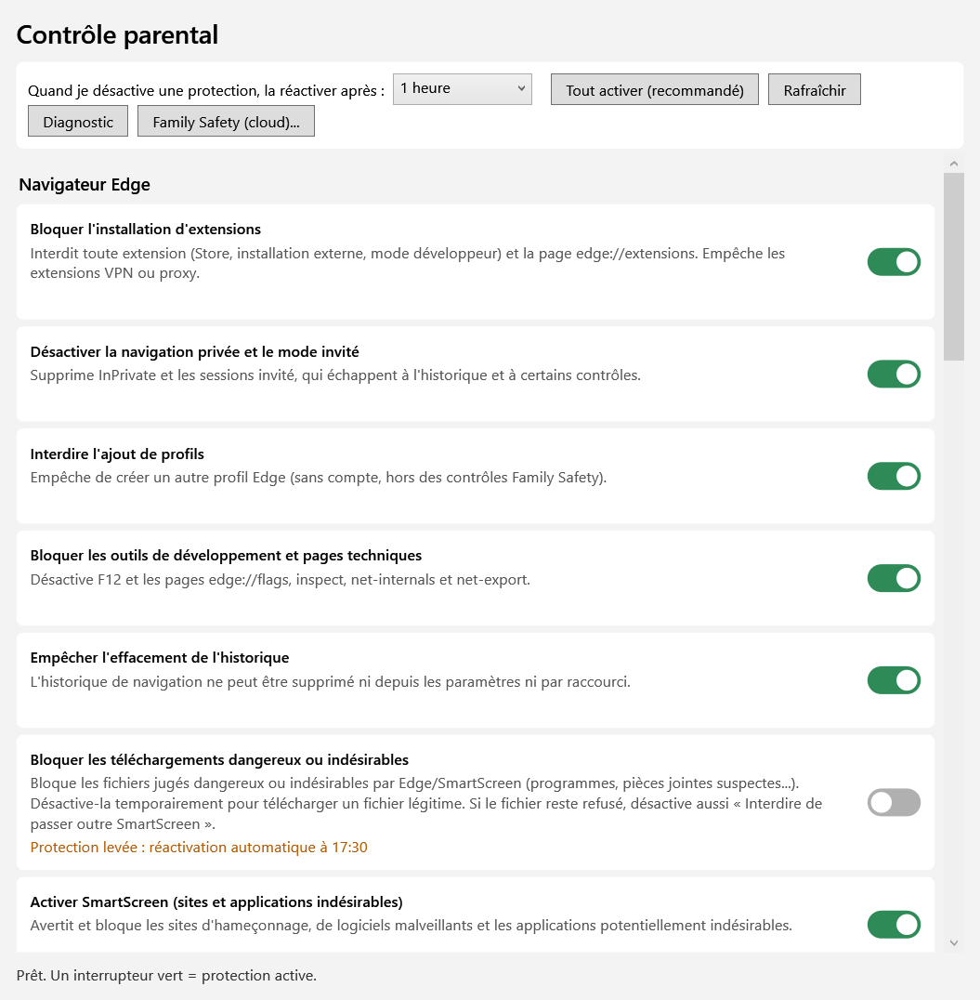
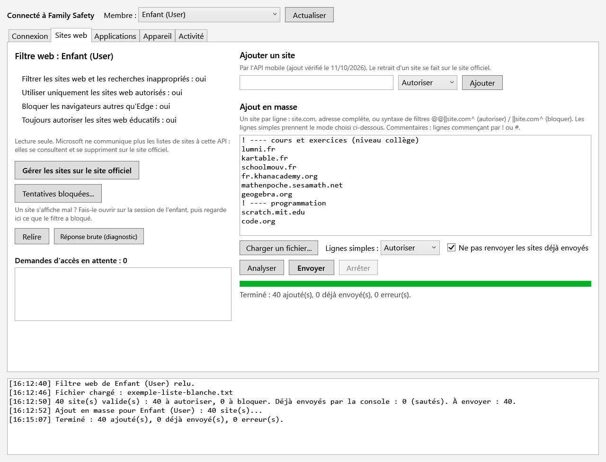

# Contrôle parental pour Windows 11

Console PowerShell (WPF) pour préparer et administrer le PC Windows d'un enfant (compte standard géré par
Microsoft Family Safety) : un interrupteur et une description par protection locale, plus une fenêtre qui pilote
Family Safety (sites autorisés, applications, temps d'écran).

> ⚠️ **API non officielle.** La partie « Family Safety (cloud) » utilise l'API mobile non documentée de
> Microsoft Family Safety, en se présentant comme l'application Android officielle (méthode reprise de
> [pyfamilysafety](https://github.com/pantherale0/pyfamilysafety)). Cet usage est probablement contraire aux
> conditions d'utilisation de Microsoft, l'API peut changer sans préavis, et ton compte familial est exposé.
> À utiliser en connaissance de cause.

## Aperçu

La console : une carte par protection, avec sa description et son interrupteur. Une protection levée se réactive
d'elle-même après le délai choisi.



La fenêtre Family Safety, onglet Sites web : réglages du filtre, ajout de sites en masse, tentatives bloquées.



*Captures réalisées avec des données fictives.*

## Fonctions

### Protections locales (25, réversibles)
- **Edge** : extensions bloquées, pas de navigation privée ni de profil invité, outils de développement bloqués,
  historique non effaçable, téléchargements dangereux bloqués, SmartScreen imposé, SafeSearch et YouTube restreint
  forcés, proxy verrouillé, DNS sécurisé (DoH) désactivé…
- **Réseau** : DNS filtrant Cloudflare Family (1.1.1.3) imposé, pare-feu bloquant tout autre DNS (ports 53 et 853).
- **Windows** : SmartScreen en mode « Bloquer », widgets et suggestions web désactivés ; en option : applications du
  Store uniquement, stockage USB désactivé, élévation refusée aux comptes standard, historique d'activités et
  localisation désactivés, maintenance hebdomadaire (fichiers temporaires, `winget upgrade`).
- **Groupes du compte enfant** : autorisations précises sans droits administrateur, choisies dans une liste fermée
  et sans risque (compteur FPS des jeux, compteurs de performance). Voir plus bas.
- **Démarrage élevé** : menu pour lancer un programme à l'ouverture de session de l'enfant — app UWP (ex. Armoury
  Crate SE) dans sa session, ou `.exe` en SYSTEM — remplacer l'accueil Xbox par ce programme (FSE), et (re)démarrer
  un service en l'élevant au compte LocalSystem (voir plus bas).
- Réactivation automatique après un délai quand tu lèves une protection (tâche planifiée SYSTEM),
  sauvegarde du registre avant chaque modification, diagnostic (comptes, navigateurs ou VPN en trop, démarrage).

### Family Safety (cloud)
- Connexion automatique : une fenêtre Edge séparée s'ouvre, tu te connectes, le jeton est stocké chiffré (DPAPI)
  dans un dossier réservé aux administrateurs.
- **Sites web** : lecture des réglages du filtre ; **ajout de sites en masse** (liste collée ou fichier, progression,
  reprise, mémoire des sites déjà envoyés, journal) ; fenêtre « Tentatives bloquées » qui lit le rapport d'activité
  pour autoriser les domaines manquants. Les listes existantes ne sont pas lisibles par cette API : elles se
  consultent et se suppriment sur [account.microsoft.com/family](https://account.microsoft.com/family/).
- **Applications** : blocage, déblocage, déblocage temporaire avec reblocage automatique.
- **Appareil** : blocage temporaire d'une plateforme, limites quotidiennes de temps d'écran.
- **Activité** : temps d'écran du jour, historique web et recherches (affichage brut), appareils.

## État (octobre 2026)
| Fonction | État |
|---|---|
| Interface, connexion Family Safety, lecture des membres et des réglages du filtre | Vérifié |
| Ajout de sites (unitaire et en masse) | Vérifié : les sites apparaissent sur le site officiel |
| Tentatives bloquées, historique web et recherches | Format des réponses non confirmé |
| Blocage d'applications, blocage d'appareil, limites de temps d'écran | Non testé en réel (gestion du fuseau horaire non confirmée) |
| Protections locales | Code vérifié, pas encore éprouvé sur un PC d'enfant : teste chacune avant de t'y fier |
| Groupes du compte enfant | Lecture des comptes et des groupes vérifiée sur ROG Ally ; effet sur le compteur FPS à confirmer |
| Démarrage élevé (UWP ou SYSTEM), remplacement de l'accueil Xbox, élévation de service | Non testé sur un appareil réel : vérifie `elevate-launch.log` et l'écran de l'enfant |

## Prérequis
- Windows 10 ou 11 (Home compris), Windows PowerShell 5.1, Microsoft Edge.
- Un compte administrateur (parent) ; l'enfant utilise un compte **standard**.
- Les fichiers `.ps1` et `.psm1` doivent rester encodés en **UTF-8 avec BOM** (accents de l'interface).

## Utilisation
Place `ControleParental.ps1` et `FamilySafety.psm1` dans le même dossier, puis :

```powershell
powershell -ExecutionPolicy Bypass -File .\ControleParental.ps1
```

Le script demande l'élévation (UAC). En ligne de commande (administrateur) :

```powershell
.\ControleParental.ps1 -Status                                  # état des protections
.\ControleParental.ps1 -Apply recommended                       # active les protections recommandées
.\ControleParental.ps1 -Revert edge-downloads                   # lève une protection
.\ControleParental.ps1 -Diagnostic                              # rapport de diagnostic
.\ControleParental.ps1 -FsImport liste.txt -FsChild Prenom      # ajout en masse de sites autorisés (-FsBlock pour bloquer)
```

## Démarrage élevé — menu « Démarrage élevé »
Sur un compte standard, certaines applications n'ont pas les droits d'agir sur le matériel, et l'accueil Xbox
plein écran (Full Screen Experience) revient toujours. Donner à l'enfant un accès administrateur réglerait le
symptôme mais annulerait Family Safety et toutes les protections. Ce menu fait le travail sans lui donner de
droits : **c'est toi, admin, qui choisis les cibles** dans la console (protégée par l'UAC) ; chaque cible est
**figée dans une tâche planifiée** que l'enfant ne peut ni voir ni modifier. Il déclenche l'ouverture de session,
mais ne choisit jamais ce qui est lancé.

### Deux types de cible
- **App Windows / UWP** (ex. **Armoury Crate SE**) : une app UWP ne peut pas tourner en SYSTEM ; elle est donc
  lancée **dans la session de l'enfant, en tant que l'enfant** (par son AUMID `PFN!AppId`, résolu depuis son nom).
- **Programme `.exe`** (Win32, ex. **Winhance**) : lancé **en SYSTEM dans la session interactive** de l'enfant
  (jeton SYSTEM injecté, comme `PsExec -s -i`), pour un outil qui a besoin des droits machine.

### Remplacer l'accueil Xbox (FSE)
Pour chaque cible tu peux renseigner « processus à tuer après le lancement » (par défaut `XboxPcApp,XboxApp,GamingApp`).
La tâche attend quelques secondes que ta cible soit affichée, **tue l'accueil Xbox**, puis **monte la garde** :
tant que la cible tourne, si l'accueil Xbox réapparaît, il est retué. Résultat : ta cible prend la place de
l'accueil plein écran, sans course au démarrage et **sans jamais montrer le bureau Windows**. C'est une version
robuste du « script qui tue Xbox » : garde continue, journal, et relance de la cible si elle disparaît (option).

### La puissance (ROG Ally) passe par le service, pas par le front-end
Armoury Crate SE étant une app UWP (non élevable), lancer le front-end ne suffit pas à régler le TDP sur un compte
standard : c'est le **service** d'Armoury Crate (compte SYSTEM) qui applique la puissance. Utilise l'onglet
**Services** pour passer le service d'Armoury Crate (ou de Winhance) en **LocalSystem + démarrage automatique** et
le redémarrer. La liste propose les services ASUS / Armoury détectés.

### Exemple ROG Ally (remplacer l'accueil Xbox par Armoury Crate)
1. Onglet **Programmes** : Type = *App UWP*, nom de l'app = `ArmouryCrate` (ou son AUMID), « tuer après » =
   `XboxPcApp,XboxApp,GamingApp`, « processus à surveiller » = `ArmouryCrate` ; Enregistrer, puis « Tester
   maintenant ».
2. Onglet **Services** : élève + redémarre le service d'Armoury Crate pour que la puissance tienne.

Journal : `C:\ProgramData\ControleParental\elevate-launch.log` ; le diagnostic affiche aussi les entrées
configurées et l'état des services ASUS.

```powershell
.\ControleParental.ps1 -ElevList                         # liste les cibles configurées
.\ControleParental.ps1 -ElevTest "ArmouryCrate"          # lance maintenant l'entrée nommée ainsi
.\ControleParental.ps1 -SvcElevate ArmouryCrateService   # élève + redémarre un service
```

> ⚠️ Lancer un `.exe` en SYSTEM lui donne les droits maximaux de la machine ; n'ajoute que des programmes de
> confiance. Ce menu ne crée aucun champ où l'enfant fournirait lui-même une cible : il ne peut pas s'en servir
> pour lancer ou élever autre chose. Vérifie les noms de processus exacts dans le Gestionnaire des tâches de ton
> appareil (ils varient selon les versions de Windows et d'Armoury Crate).

## Groupes du compte enfant — bouton « Groupes du compte enfant »
Certaines fonctions des jeux demandent une autorisation Windows qu'un compte standard n'a pas, sans pour autant
justifier des droits administrateur. Exemple : sur ROG Ally, Armoury Crate n'affiche pas les FPS sur le compte
de l'enfant, parce que compter les images d'un jeu passe par le traçage d'événements Windows (ETW).

La fenêtre propose une **liste fermée** de groupes locaux, avec un interrupteur par groupe :

| Interrupteur | Groupe Windows | Effet |
|---|---|---|
| Compteur FPS dans les jeux | Utilisateurs du journal de performances (`S-1-5-32-559`) | Overlays FPS (Armoury Crate, Xbox Game Bar, PresentMon) |
| Compteurs de performance | Utilisateurs de l'Analyseur de performances (`S-1-5-32-558`) | Lecture des compteurs CPU, GPU, mémoire |

Effet à la **prochaine ouverture de session** de l'enfant. Volontairement absents : Administrateurs, Opérateurs de
configuration réseau (pourrait changer le DNS et contourner le filtre), Opérateurs de sauvegarde (lecture de tout
fichier, chemin connu vers l'admin), Propriétaires d'appareil, Hyper-V et accès à distance. Seuls les comptes
standard actifs sont proposés.

```powershell
.\ControleParental.ps1 -GroupGrant perf-log -Child isaac    # accorde (perf-log ou perf-mon)
.\ControleParental.ps1 -GroupRevoke perf-log -Child isaac   # retire
```

## Liste blanche
`exemple-liste-blanche.txt` est une proposition pour un enfant de 11 ans (collège, francophone), à adapter.
Format : un site par ligne (`site.com`, adresse complète, ou `@@||site.com^` / `||site.com^`), commentaires
avec `!` ou `#`. Après un envoi, recharge la page officielle (Ctrl+F5) pour voir les sites.

## Données locales
Tout est rangé dans `C:\ProgramData\ControleParental` : copie installée du script, sauvegardes du registre,
journaux, `secrets\` (jeton chiffré, réservé à SYSTEM et aux administrateurs).

## Crédits et licence
- Conçu par [kvernNC](https://github.com/kvernNC) et développé avec
  [Claude](https://www.anthropic.com/claude) (Anthropic), via Claude Code : code, interface, analyse de l'API et tests.
- Méthode d'authentification et points d'accès de l'API mobile repris de
  [pyfamilysafety](https://github.com/pantherale0/pyfamilysafety) (MIT, © 2023 Jordan H) ; la notice figure
  dans `FamilySafety.psm1`.
- Projet sous licence MIT (voir `LICENSE`). Aucune garantie : teste chaque protection avant de t'y fier.
